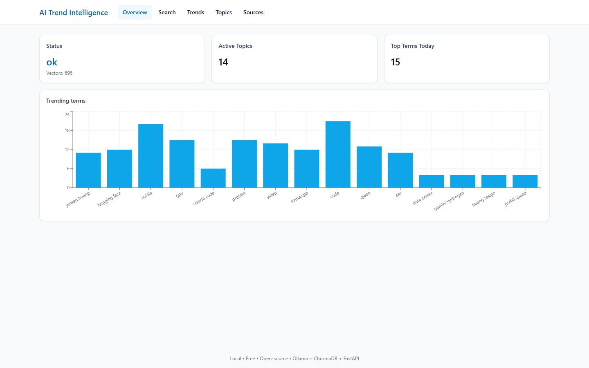
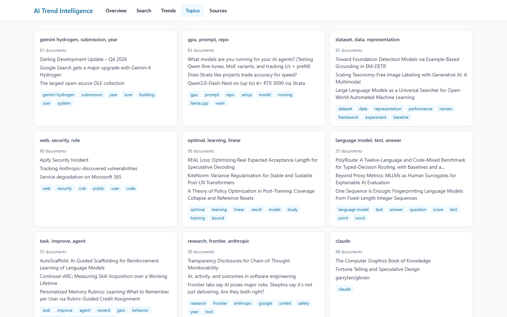
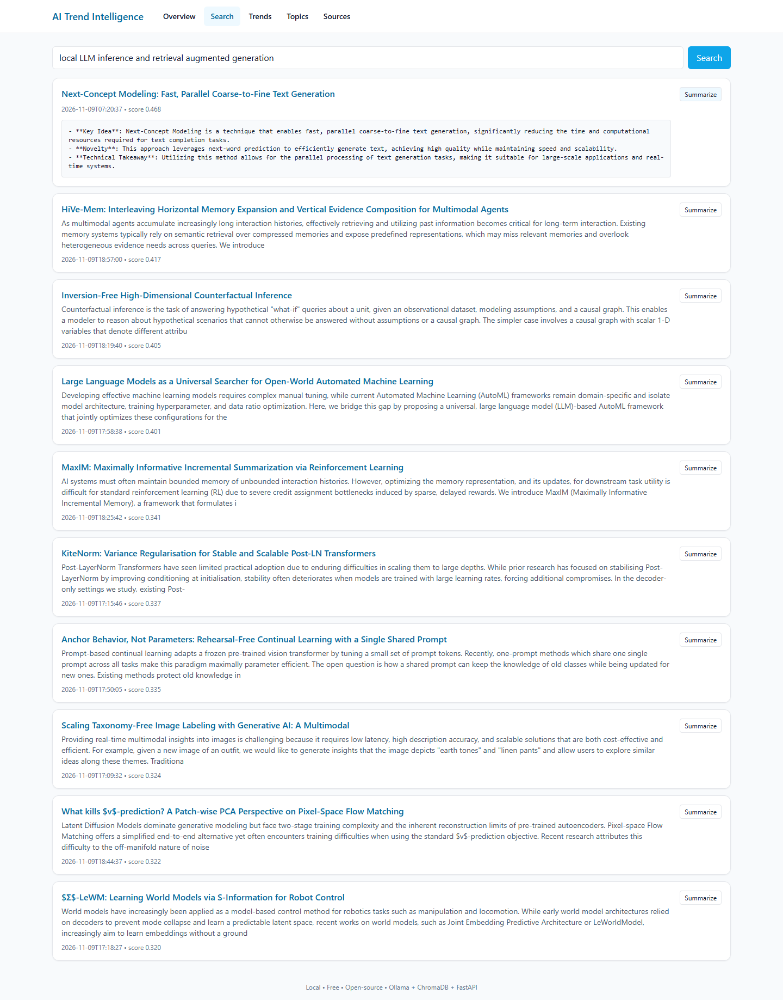

# AI Developer Trends Intelligence Platform

A 100% free, locally-runnable, full-stack AI platform that scrapes developer/AI signals from across the web, transforms them into a clean structured corpus, generates **local** embeddings, performs **semantic search**, detects **trending topics**, and produces **AI summaries** using **Ollama** — all served through a FastAPI backend and a modern React dashboard.

> No paid APIs. No OpenAI. No proprietary services. Everything runs locally or via free public endpoints.

---

## Features

- **Multi-source scraping**: Reddit (JSON, with Atom-feed fallback), Hacker News API, GitHub Trending, arXiv
- **ETL pipeline**: raw → cleaned → deduplicated → normalized
- **Local embeddings**: `sentence-transformers/all-MiniLM-L6-v2`
- **Vector search**: ChromaDB
- **Local LLM summaries**: Ollama (`llama3` / `mistral`)
- **Trend detection**: time-bucketed term and phrase frequencies compared against a 7-day baseline, plus k-means topic clustering
- **REST API**: FastAPI + Swagger
- **Dashboard**: React + Vite + Tailwind + Recharts
- **Production layout**: Docker, docker-compose, Alembic migrations, structured logging

---

## Screenshots

**Overview** — pipeline status, active topics and the day's trending terms:



**Topics** — k-means clusters over local embeddings, each with its most representative headlines and distinctive keywords:



**Semantic search** with an on-demand local LLM summary (Ollama):



---

## Architecture

```
+-----------+      +-----------+      +--------------+      +-----------+
|  Sources  | ---> |  Scrapy   | ---> |  ETL/Clean   | ---> | Postgres  |
| Reddit/HN |      | Playwright|      | Dedup/Norm   |      |  SQLite   |
| GH/arXiv  |      +-----------+      +--------------+      +-----------+
+-----------+                                 |                   |
                                              v                   v
                                       +-------------+      +-----------+
                                       | Embeddings  | ---> | ChromaDB  |
                                       | (MiniLM)    |      | (vectors) |
                                       +-------------+      +-----------+
                                              |
                                              v
                                       +-------------+      +-----------+
                                       |  FastAPI    | <--> |  Ollama   |
                                       |  /search    |      | (llama3)  |
                                       |  /trends    |      +-----------+
                                       |  /summary   |
                                       +------+------+
                                              |
                                              v
                                       +-------------+
                                       |  React UI   |
                                       | Vite+Tailw. |
                                       +-------------+
```

---

## Quick Start (Docker)

```bash
docker compose up --build
```

- Backend: http://localhost:8000/docs
- Frontend: http://localhost:5173
- Ollama: http://localhost:11434

Pull a model the first time:

```bash
docker exec -it ollama ollama pull llama3
```

---

## Local Development

### Backend

```bash
cd backend
python -m venv .venv
.venv\Scripts\activate     # Windows
pip install -r requirements.txt
uvicorn app.main:app --reload
```

### Frontend

```bash
cd frontend
npm install
npm run dev
```

### Run a scrape + ETL + embed cycle

```bash
python -m backend.scripts.run_pipeline
```

---

## API

| Method | Endpoint     | Purpose                        |
|--------|--------------|--------------------------------|
| GET    | `/health`    | Liveness                       |
| GET    | `/sources`   | List configured data sources   |
| GET    | `/search`    | Semantic search                |
| GET    | `/trends`    | Trending topics (daily/weekly) |
| GET    | `/topics`    | Clustered topics               |
| POST   | `/summary`   | LLM summary of a doc/topic     |

Full Swagger UI at `/docs`.

---

## Project Structure

```
ai-trend-intelligence-platform/
├── backend/
│   ├── app/
│   │   ├── api/            # FastAPI routers
│   │   ├── services/       # search, trends, summary
│   │   ├── models/         # SQLAlchemy
│   │   ├── db/             # session, base
│   │   ├── embeddings/     # MiniLM + Chroma
│   │   ├── ai/             # Ollama client
│   │   ├── scraping/       # Scrapy spiders + clients
│   │   ├── pipelines/      # ETL jobs
│   │   ├── utils/          # logging, time, config
│   │   ├── config.py
│   │   └── main.py
│   ├── scripts/
│   ├── alembic/
│   ├── tests/
│   └── requirements.txt
├── frontend/
│   ├── src/
│   │   ├── pages/
│   │   ├── components/
│   │   ├── api/
│   │   └── main.tsx
│   ├── index.html
│   ├── package.json
│   └── tailwind.config.js
├── docker/
│   ├── backend.Dockerfile
│   └── frontend.Dockerfile
├── docs/
├── scripts/
├── docker-compose.yml
├── .env.example
└── README.md
```

## Future Improvements

- Real-time websocket updates
- Redis-backed background workers (RQ / Celery)
- Multi-language summarization
- Author/entity graph
- HuggingFace dataset export
- Fine-tuned local re-ranker

---

## License

MIT
